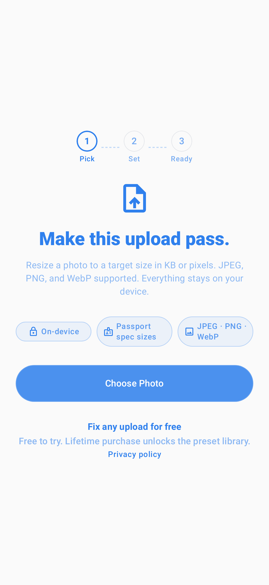
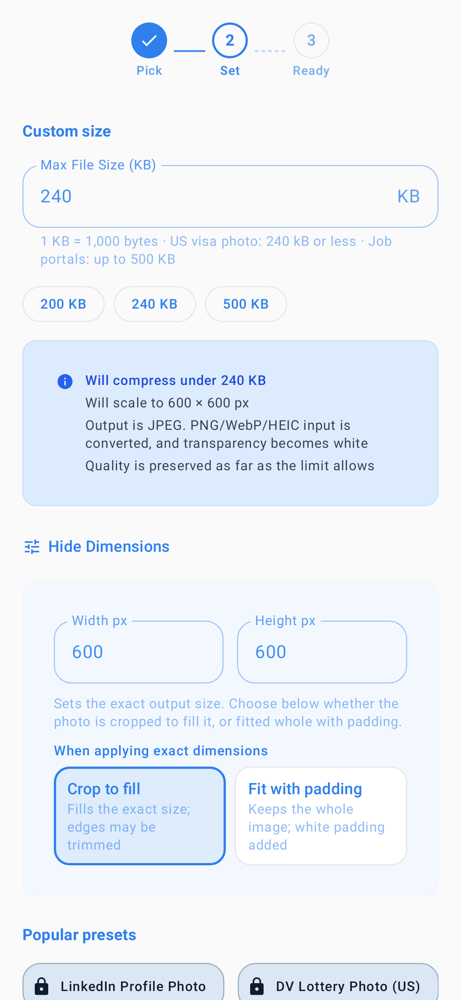
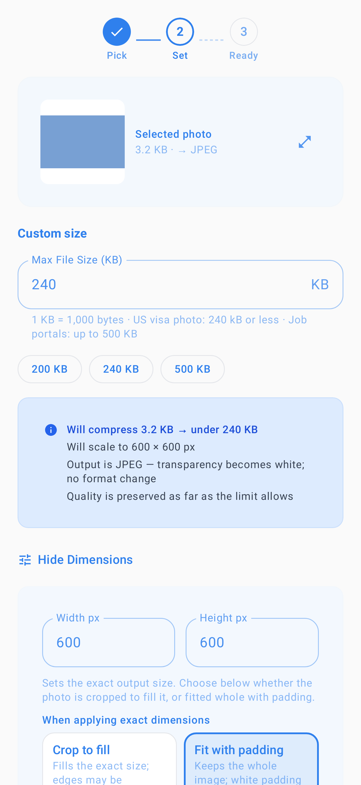

# ExactUploadFixer

Resizes and compresses photos (JPEG, PNG, or WebP input; JPEG output) to meet explicit size and dimension targets you set (width, height, max bytes; 1 KB = 1,000 bytes). Includes a free manual tier and Pro presets that encode sourced, dated size constraints for specific upload routes — file limits only, never acceptance guarantees. See PLAY_RELEASE.md for release status.

## See the interface

Pick a photo → set dimensions and a byte cap → choose crop or fit-with-padding.
These are **existing Roborazzi/Robolectric UI test snapshots**, inspected from
[`b102ab367ce2`](https://github.com/gthgomez/ExactUploadFixer/tree/b102ab367ce2f8686d6553d0686e53072d5ddd18) on 2026-10-30.
They show isolated Compose screens with staged state and synthetic image data;
they are not fresh device screenshots or an end-to-end compression demo.

| 1 · Pick | 2 · Set a crop | 3 · Fit with padding |
| --- | --- | --- |
|  |  |  |

The gallery shows the committed UI, including historical promotional copy; the
preset limitations below remain authoritative. The third image uses a generated
solid-color fixture, not a personal photo. No video is available yet: this cloud
environment has no Android SDK, emulator, or attached device.
[Snapshot provenance and real-device capture checklist](docs/showcase/README.md).

### Try it locally

Use JDK 17 and Android SDK platform 36 with an Android 8.0+ test device or emulator.
The checked-in `DesignSystem/` composite is part of the build. From the repo root
(Windows: `gradlew.bat`):

```sh
./gradlew :app:assembleGooglePlayDebug :app:testGooglePlayDebugUnitTest
```

**Presets are constraint sets, not eligibility certificates.** Meeting a preset's dimensions and byte cap does not validate identity, pose, background, image content, or final acceptance — every receiving authority reviews and decides. No guaranteed-acceptance claim is made or implied.

Each official preset cites its source (`authorityUrl`), the specific application context, the verification date (`lastVerified`), and how the authority's written byte limit was interpreted. Presets older than the 90-day recheck window are visibly flagged for recheck rather than presented as automatically current. Per-preset source/context/date/interpretation table: [docs/engineering/preset-sources.md](docs/engineering/preset-sources.md).

Byte limits are stated in exact bytes. Where an authority writes "kB" without defining it (e.g. the US State Dept "240 kB" rule), the stricter decimal reading (240,000 bytes) is applied so the output satisfies either interpretation; the cited interpretation is recorded per preset and covered by unit tests.

> **Status: proprietary.** This repository is public for source visibility and
> transparency. It is **not open source** — there is no license grant to reuse,
> modify, or redistribute this code. See [LICENSE](LICENSE).

**Tech stack:** Kotlin, Jetpack Compose, Material3, Google Play Billing (Amazon IAP for Amazon flavor), ExifInterface, SAF file export.

**Build (Google Play):** `.\gradlew.bat :app:assembleGooglePlayDebug`
**Build (Amazon):** `.\gradlew.bat :app:assembleAmazonDebug`
**Tests (Google Play):** `.\gradlew.bat :app:testGooglePlayDebugUnitTest`
**Tests (Amazon):** `.\gradlew.bat :app:testAmazonDebugUnitTest`

**Project docs:** [STATUS.md](STATUS.md) | [PRIVACY.md](PRIVACY.md) | [QA_CHECKLIST.md](QA_CHECKLIST.md) | [SHIP_CHECKLIST.md](SHIP_CHECKLIST.md)

**Agent instructions:** [AGENTS.md](AGENTS.md); technical context in [docs/PROJECT_CONTEXT.md](docs/PROJECT_CONTEXT.md) (task data).
